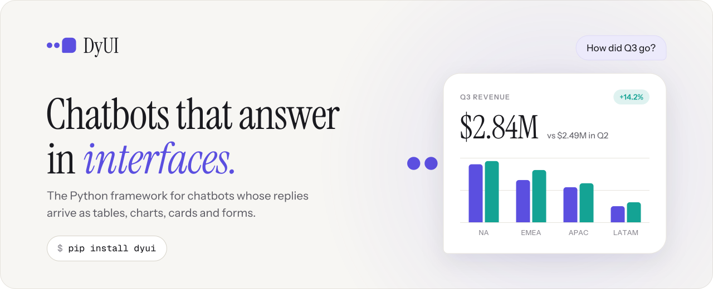
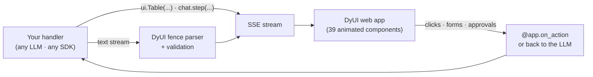

<div align="center">

<picture>
  <source media="(prefers-color-scheme: dark)" srcset="brand/readme-hero-dark.svg">
  
</picture>

<br/>

[](https://pypi.org/project/dyui/)
[](https://pypi.org/project/dyui/)
[](https://github.com/sohammmzzz/dyui/actions/workflows/ci.yml)
[](https://sohammmzzz.github.io/dyui/)
[](LICENSE)

**[Documentation](https://sohammmzzz.github.io/dyui/)** · **[Quickstart](#quickstart)** · **[Components](#39-components-ready-to-render)** · **[Examples](examples/)** · **[Changelog](https://sohammmzzz.github.io/dyui/changelog/)**

</div>

---

**DyUI is the Python framework for professional chatbots that answer in interfaces.**
Write one Python file, run `dyui run app.py`, and get a calm, beautifully animated chat app —
frontend and backend — where **your LLM replies with tables, charts, cards, forms and buttons**,
not just text.

```python
import dyui

app = dyui.App(title="Travel Bot", starters=["Plan a weekend in Lisbon"])

@app.on_message
async def reply(msg: dyui.Message, chat: dyui.Chat):
    async for part in dyui.llm.stream("openai/gpt-5", chat.history,
                                      system="You are a calm, expert travel agent.",
                                      components=app.catalog):   # ← the LLM can now render UI
        yield part
```

```bash
pip install "dyui[openai]"
dyui run app.py          # → http://127.0.0.1:8000
```

No API key yet? `pip install dyui && dyui demo` opens a guided tour that needs none.

<!-- SCREENSHOTS: app hero (light/dark) is added at release time from the real app. -->

## Why DyUI

<table>
<tr>
<td width="33%" valign="top">

**The LLM renders UI.**
DyUI teaches your model a component catalog through an auto-generated system prompt, parses
its output *while it streams*, validates it, and renders it — inline, between sentences.

</td>
<td width="33%" valign="top">

**Professional out of the box.**
Conversation history, streaming with stop, regenerate and edit, file uploads, feedback,
light and dark themes, mobile layout, password gate — calm motion at every interaction.

</td>
<td width="33%" valign="top">

**Any model. Any framework.**
OpenAI, Anthropic, Ollama, Groq, OpenRouter, Gemini, Mistral, DeepSeek, xAI, LangGraph —
or your own SDK. DyUI parses raw text, so anything that streams works.

</td>
</tr>
<tr>
<td valign="top">

**Your own components, in pure Python.**
Define a pydantic model with a `render()`; the LLM learns it automatically. The system prompt
grows with your app.

</td>
<td valign="top">

**Interfaces that talk back.**
Buttons, forms, choices and approvals route to Python handlers — or straight back to the LLM.
`await chat.ask(...)` pauses an agent for human approval.

</td>
<td valign="top">

**Safe by design.**
The model only ever sends data. No model HTML, sanitized links, verified actions, sandboxed
developer templates.

</td>
</tr>
</table>

## Quickstart

```bash
pip install dyui
dyui new my-bot --template openai     # or: basic · anthropic · langgraph
cd my-bot && dyui run
```

`dyui run` serves the app and reloads it whenever you save. `app` is a standard ASGI app, so
`uvicorn app:app` works in production too.

## How the LLM writes UI

DyUI adds a short, generated section to your system prompt that lists the components your bot
may use. The model writes ordinary Markdown, and puts components in fenced `dyui` blocks — one
JSON object per line:

````text
Here are two options for this weekend.
```dyui
{"ui":"flight","airline":"TAP","depart":"Fri 18:05","price":189}
{"ui":"quick_replies","options":["Check hotels too","Book the cheaper one"]}
```
Want me to hold a seat?
````

The server parses that stream incrementally. A component appears as a soft skeleton the moment
its type is known, fills in as its props arrive, and blooms into place when the line completes.
Invalid output degrades to a quiet "couldn't display" chip — the prose is never lost.



## Your component library — the prompt grows with your app

```python
from dyui import ui

@app.component
class Flight(dyui.Component):
    """A bookable flight option. Use when listing specific flights."""
    airline: str
    depart: str
    price: float

    def render(self):
        return ui.Card(self.airline, ui.Stat("Price", f"${self.price:.0f}"),
                       actions=[ui.Button("Book", action="book_flight", data=self.model_dump())])

@app.on_action("book_flight")
async def book(action: dyui.Action, chat: dyui.Chat):
    confirm = await chat.ask(ui.Confirm("Book this flight?", text=action.data["airline"]))
    if confirm.values.get("confirmed"):
        yield ui.Callout("Booked — your confirmation is on its way.", level="success")
```

Register a component and the next turn's system prompt includes it. Change a field or the
docstring and the prompt changes with it. Choose what each bot — or each turn — may use:

```python
dyui.App(components=["table", "chart", "stat", "buttons"])   # a subset of built-ins
app.catalog.only("flight", "confirm", "quick_replies")        # per turn, e.g. at checkout
```

`dyui catalog app.py` prints the exact prompt DyUI will send, with a token estimate.

## 39 components, ready to render

| group | components |
|---|---|
| **Content** | `markdown` · `callout` · `code` · `quote` · `sources` · `badges` · `divider` |
| **Data** | `table` · `stat` · `stats` · `keyvalue` · `chart` (bar · line · area · pie · donut · scatter) · `progress` · `timeline` · `json` |
| **Media** | `image` · `gallery` · `video` · `audio` · `file` · `link_preview` |
| **Interactive** | `buttons` · `quick_replies` · `choice` · `form` · `confirm` · `rating` |
| **Layout** | `card` · `grid` · `tabs` · `accordion` · `carousel` · `list` |
| **Agent** | `step` · `reasoning` · `plan` |

Every component blooms in, streams gracefully while the model is still writing it, works in
light and dark, respects reduced-motion, and is keyboard accessible.
[Browse them all with live demos →](https://sohammmzzz.github.io/dyui/components/)

## Works with

| | |
|---|---|
| **Built-in streaming** | `openai/…` · `anthropic/…` · `ollama/…` · `groq/…` · `openrouter/…` · `gemini/…` · `mistral/…` · `deepseek/…` · `together/…` · `xai/…` |
| **Agent frameworks** | LangGraph (`dyui.integrations.langgraph`) — emit components from any node |
| **Anything else** | Yield raw text from any SDK and add `app.catalog.prompt()` to your system prompt |

## Steps, reasoning and human-in-the-loop

```python
@app.on_message
async def reply(msg, chat):
    async with chat.step("Searching flights", type="search") as step:
        step.output = await search_flights(msg.text)          # live status + duration
    yield ui.Table(columns=["Airline", "Depart", "Price"], rows=to_rows(step.output))
```

Reasoning models stream their thinking into a collapsible block automatically.

## CLI

| command | |
|---|---|
| `dyui run [app.py]` | Serve your app with hot reload (`--host`, `--port`, `--open`) |
| `dyui new <dir>` | Scaffold a project (`basic`, `openai`, `anthropic`, `langgraph`) |
| `dyui demo` | A guided tour — no API key needed |
| `dyui catalog [app.py]` | Print the generated UI prompt and its token cost |
| `dyui claude init` | Hand your app to Claude Code to design custom components (`gemini` / `codex` too) |

## Deploy

```bash
uvicorn app:app --host 0.0.0.0 --port 8000
```

DyUI stores conversations in SQLite (`./.dyui/dyui.db`) by default. Pass `persist=False` for
memory-only, or plug in your own `Store`. See [Deploy](https://sohammmzzz.github.io/dyui/deploy/production/)
for Docker, reverse proxies and hosting guides.

## Roadmap

- `dyui-react` — the same components for your own React / Next.js app (npm)
- Tool-calling render mode (one `render_<component>` tool per component)
- Conversation branching, voice, and a side panel for long artifacts
- Auth providers (OAuth) and multi-user workspaces

## Repository

| path | |
|---|---|
| [`python/`](python/) | the `dyui` package (framework, server, CLI) |
| [`web/`](web/) | the chat app and component library (React, bundled into the wheel) |
| [`docs/`](docs/) | the documentation site (Astro Starlight) |
| [`examples/`](examples/) | runnable example bots |
| [`SPEC.md`](SPEC.md) | the engineering spec: protocol, component catalog, brand |

Contributions are welcome — start with [`SPEC.md`](SPEC.md), then
`cd web && npm install && npm run build:py` and `pip install -e "python[all,dev]"`.

## License

[MIT](LICENSE) © DyUI contributors
