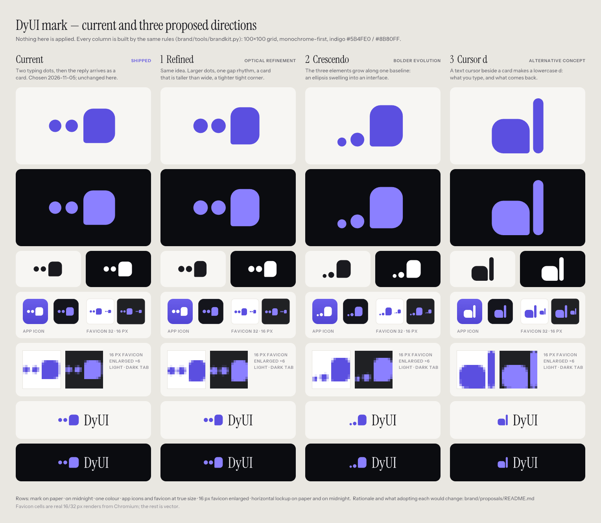

# Mark proposals (not applied)

Three directions for the DyUI mark, next to the shipped one. Nothing outside this folder uses
them. Compare on `contact-sheet.png` (view at 100%: the favicon cells are real 16/32 px renders).



Each folder has `mark.svg`, `mark-mono.svg`, `mark-white.svg`, `app-icon-light.svg`,
`app-icon-dark.svg`, `favicon.svg`, `lockup.svg`, `lockup-dark.svg`. Geometry is on the same
100×100 grid as the shipped mark and is defined in `brand/tools/proposals.py`.

## 1. Refined (`1-refined/`) — optical refinement of "Typing → Card"

- Same idea, same three elements. Dots grow from r 9 to r 10.5; they were the first thing to thin out at 16 px.
- One gap rhythm: 5 between the dots, 7 to the card (was 6 and 8).
- Card goes from 46×50 to 42×54, so it reads as a card and less as a square button. Radii stay 14; the tight corner goes from 4 to 3.5.
- At 16 px the card is exactly 7×9 px and each dot 3.5 px.
- Trade-off: the mark is a little taller, so in the lockup it is narrower at the same cap height. The change is subtle; most people will not notice it happened.

Geometry: dots r 10.5 at (12.5, 50) and (38.5, 50); card
`M70 23H84A14 14 0 0 1 98 37V63A14 14 0 0 1 84 77H59.5A3.5 3.5 0 0 1 56 73.5V37A14 14 0 0 1 70 23Z`.

## 2. Crescendo (`2-crescendo/`) — bolder evolution

- The same three elements, now growing along one baseline: small dot, larger dot, card. An ellipsis swelling into an interface.
- The tight corner gains a reason: it is where the card meets the baseline the dots sit on.
- In the lockup the dots sit on the wordmark's baseline like punctuation.
- Trade-offs: the first dot is about 2 px at 16 px and nearly disappears; the mass sits low and to the right, so it is harder to centre in a tile; the rising trail can read as a "thought bubble".

Geometry: dots r 6.5 at (9.5, 73.5) and r 10 at (32, 70); card
`M66 20H82A16 16 0 0 1 98 36V64A16 16 0 0 1 82 80H54A4 4 0 0 1 50 76V36A16 16 0 0 1 66 20Z`.

## 3. Cursor d (`3-cursor-d/`) — alternative concept

- A text cursor standing beside a card makes a lowercase d: what you type, and what comes back.
- Two elements, the strongest silhouette at 16 px of the four, and it fills a square tile well.
- Outside the avoided territory (no sparkle, petals, rings, blob, pin, four-square, layers).
- Trade-offs: it gives up the typing-dots moment the product animates today; a d next to "DyUI" repeats the initial; solid-bowl d shapes exist elsewhere, and at a glance it can read as a bar beside a block. Treat it as the weakest fit of the three unless a letter mark is wanted.

Geometry: bowl `M30 40H51A17 17 0 0 1 68 57V86A4 4 0 0 1 64 90H30A17 17 0 0 1 13 73V57A17 17 0 0 1 30 40Z`;
stem: rect x 73, y 10, 15×80, radius 7.5.

## Adopting a direction

For 1 or 2 (same parts, new numbers):

1. `brand/tools/brand_svgs.py`: replace `MARK_D` and the `MARK = Mark(...)` values (`box`, `cx`, `icon_w`, `favicon_vb`) with the ones from `proposals.py`, then run it and `render.cjs` (see `brand/BRAND.md`). That regenerates every asset in `brand/` and `web/public/favicon.svg`.
2. `web/src/shell/Logo.tsx`: update `DOT_1`, `DOT_2`, `CARD`, `WIDE_BOX` (1: `0 21 100 58`; 2: `0 18 100 64`) and the three `transformOrigin` strings (dot centres, and the card's bottom-left corner: `56px 77px` for 1, `50px 80px` for 2). Check the `1.6` width factor in `BloomLogo`, since the mark is less wide.
3. `web/src/shell/shell.css`: the thinking animation targets `.sh-mark-dot` and `.sh-mark-card`; it keeps working, but for 2 check the dot bounce distance against the smaller first dot.
4. Update the geometry notes in `SPEC.md` §1.2, `brand/BRAND.md` and the web visual snapshots, if any include the mark.

For 3 (different parts): everything above, plus `Logo.tsx` must draw a bowl and a stem instead of two dots and a card, and the motion needs redesigning (assemble order; the "typing" state would become a blinking caret), with matching changes to the `.sh-mark-*` rules in `shell.css` and the description in `SPEC.md`.

## Regenerating this folder

```
python brand/tools/proposals.py
node brand/tools/render.cjs brand/proposals/px-jobs.json
python brand/tools/proposals.py
node brand/tools/render.cjs brand/proposals/sheet-jobs.json
```
